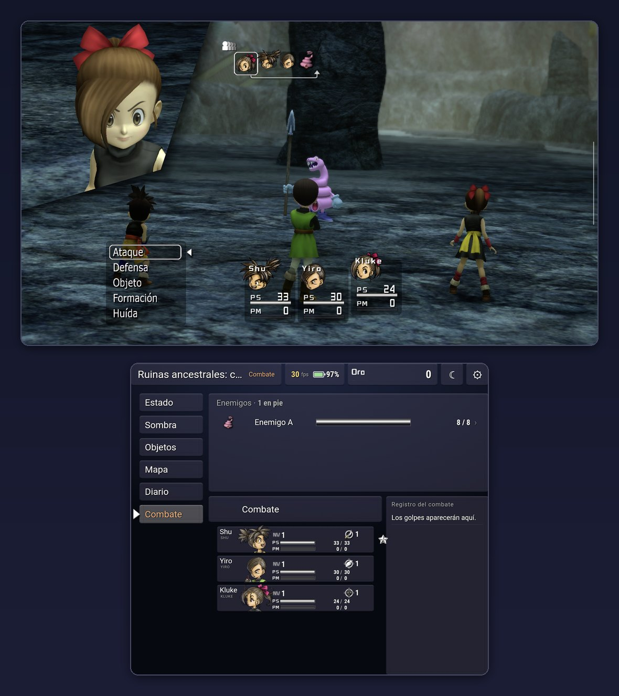
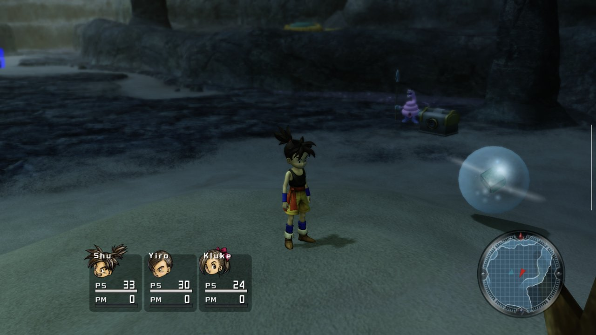
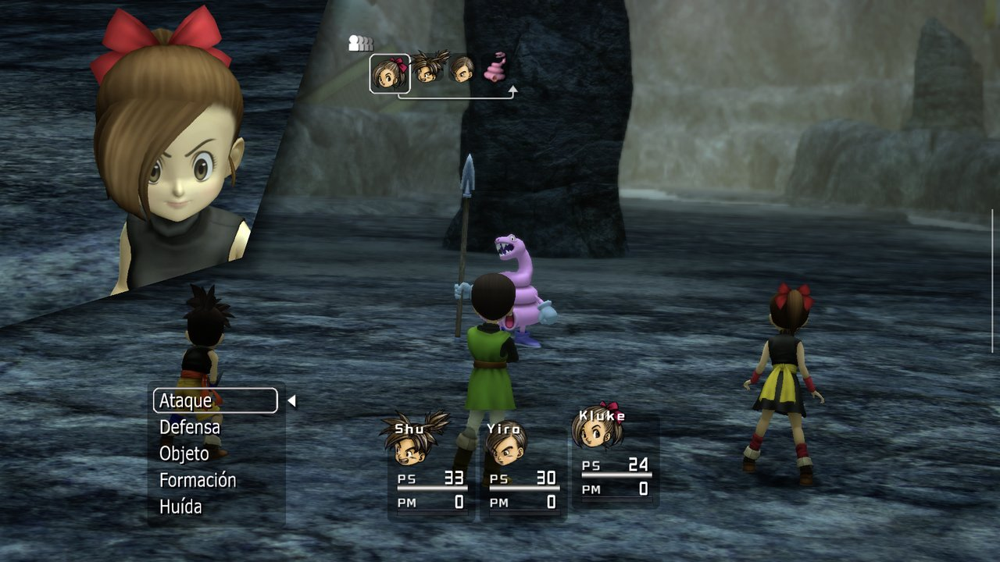
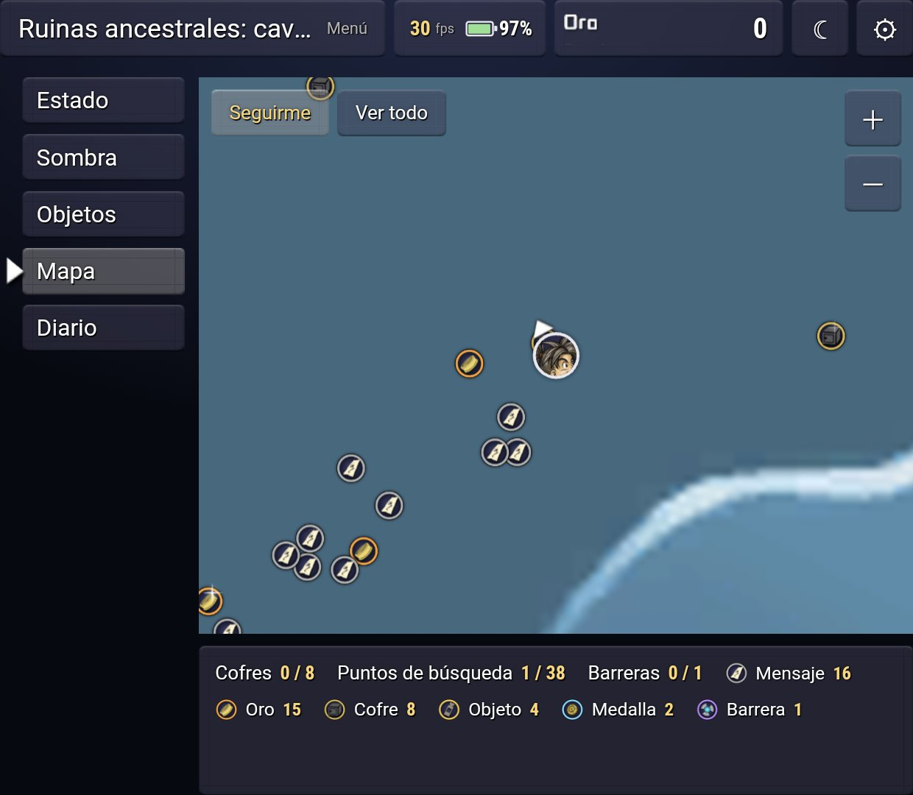
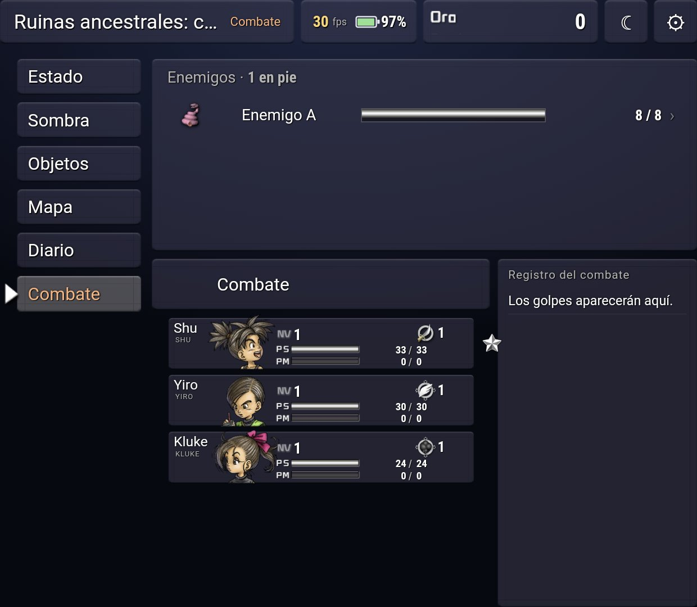
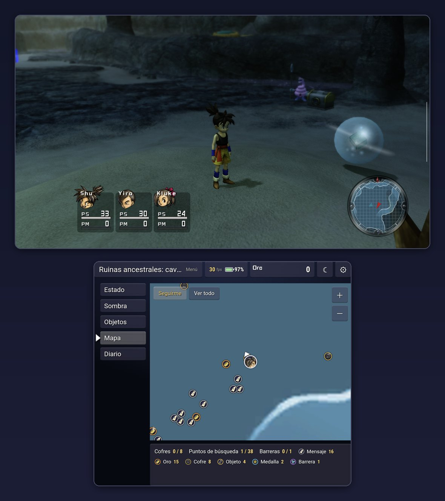
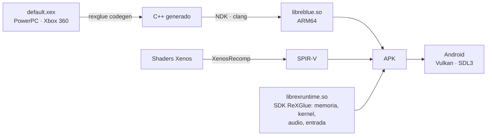

<div align="center">

# re:Blue para Android

**Blue Dragon recompilado de forma nativa para Android ARM64, con panel en vivo para consolas de doble pantalla.**

[](https://github.com/zackfairestar-debug/reblue-android/releases/latest)
[](https://github.com/zackfairestar-debug/reblue-android/releases)


[Descargar](https://github.com/zackfairestar-debug/reblue-android/releases/latest) · [Instalación](#instalación) · [Cómo funciona](#cómo-funciona) · [Compilar](README-ANDROID.md)



</div>

> [!IMPORTANT]
> **Necesitas tus propios discos de Blue Dragon** (versión Global: EE. UU./Europa). El APK lleva el código del juego recompilado, pero ningún dato: ni gráficos, ni audio, ni vídeos. El juego se instala desde tus ISOs la primera vez que lo abres.

## Qué es

re:Blue para Android es el port a Android de [re:Blue](https://github.com/zolaware/reblue), la recompilación de Blue Dragon (Xbox 360). No es un emulador: el código PowerPC del juego se tradujo a C++ y se compiló como código nativo ARM64. Por eso funciona con fluidez en consolas portátiles Android y en móviles potentes, gasta menos batería que un emulador y no necesita un PC al lado.

## Características

| | |
|---|---|
| 🎮 **Juego nativo** | Unas 17 000 funciones del juego traducidas a ARM64, con renderizado Vulkan. La lógica va a 30 Hz, como en la Xbox 360, y la imagen puede subir a 60 fps. |
| 🖥️ **Segunda pantalla** | En consolas de doble pantalla (AYN Thor y similares), la pantalla de abajo muestra un panel en vivo con el estilo del menú del juego: grupo, clases de sombra, objetos, mapa de la zona, diario de viaje y combate. |
| ⚡ **Driver GPU Turnip** | Puedes elegir un driver Mesa Turnip para GPUs Adreno, descargarlo desde la propia app y volver al de Qualcomm cuando quieras. En el Thor, la GPU tarda un 44 % menos por fotograma. |
| 🔋 **Ahorro de energía** | En el modo Automático juega a 30 fps con batería y a 60 con el cargador, y baja a 30 si la consola se calienta. La resolución interna es 720p de serie. |
| 🧠 **Núcleos rápidos** | Los hilos del juego solo corren en los núcleos de alto rendimiento, y el audio tiene prioridad de tiempo real. |
| 🕹️ **Controles** | Mando físico (Bluetooth o USB) o controles táctiles. El juego los ve como un mando de Xbox 360. |

## Capturas

<table>
  <tr>
    <td width="50%"></td>
    <td width="50%"></td>
  </tr>
  <tr>
    <td align="center"><sub>Exploración: Ruinas ancestrales</sub></td>
    <td align="center"><sub>Combate por turnos</sub></td>
  </tr>
  <tr>
    <td></td>
    <td></td>
  </tr>
  <tr>
    <td align="center"><sub>Panel: mapa con lo que queda por encontrar</sub></td>
    <td align="center"><sub>Panel: combate en vivo</sub></td>
  </tr>
</table>

<details>
<summary><b>Las dos pantallas a la vez (exploración)</b></summary>
<br>
<div align="center"></div>
</details>

## Requisitos

| | Mínimo | Recomendado |
|---|---|---|
| **Sistema** | Android 13, ARM64 | Android 13 o superior |
| **GPU** | Vulkan 1.2 | Adreno 730/740 o superior (Snapdragon 8 Gen 1/2) |
| **RAM** | 8 GB | 12 GB o más |
| **Espacio** | ~15 GB para el juego instalado y espacio temporal para las 3 ISOs mientras se instala | |
| **Juego** | Las 3 ISOs de Blue Dragon (Global) | |

Probado en un **AYN Thor** (Snapdragon 8 Gen 2, Adreno 740, doble pantalla). Las GPUs Mali suelen tener drivers Vulkan menos fiables.

## Instalación

1. **Descarga** `reblue-android-vX.Y.Z-arm64.apk` desde la [última versión](https://github.com/zackfairestar-debug/reblue-android/releases/latest) e instálalo. Android te pedirá permiso para instalar apps de origen desconocido.
2. **Copia tus 3 ISOs** de Blue Dragon al móvil, por ejemplo a `Descargas`.
3. **Abre re:Blue.** Aparece el instalador: toca cada disco y elige su ISO en el selector de archivos de Android.
4. **Juega.** El juego queda instalado en `Android/data/org.reblue.android/files/`. Ya puedes borrar las ISOs.

Las versiones nuevas se instalan encima de la anterior y conservan el juego y las partidas.

<details>
<summary><b>Dónde están las partidas, los ajustes y los logs</b></summary>
<br>

Dentro de `Android/data/org.reblue.android/files/`, que también se ve desde el PC por USB:

| Carpeta | Contenido |
|---|---|
| `game/` | Los archivos del juego instalados desde tus ISOs |
| `profiles/` | Las partidas y la configuración (`reblue.toml`) |
| `mods/` | Mods de re:Blue |
| `logs/` | Registros, útiles si algo falla |

</details>

### Driver GPU (opcional, Adreno)

Mantén pulsado el icono de re:Blue y elige **Driver GPU**. Desde ahí puedes descargar un driver Turnip (KIMCHI, Mr. Purple, Weab-Chan, Whitebelyash), instalar un `.zip` o volver al **driver del sistema**. Si un driver no llega a arrancar el juego, la app vuelve sola al de Qualcomm en el siguiente inicio.

| Driver (AYN Thor, pantalla de título) | GPU por fotograma |
|---|---|
| Qualcomm (sistema) | 4,8 ms |
| **Turnip T30 de Mr. Purple** | **2,7 ms** |
| Turnip v26.0.0 R8 de KIMCHI | 4,8 ms |

## Cómo funciona



- **Recompilación estática.** [ReXGlue](https://github.com/rexglue/rexglue-sdk) traduce cada función PowerPC del ejecutable a C++, y el NDK la compila a ARM64. En Android las funciones se llaman entre sí con saltos directos, sin pasar por la PLT, y los accesos vectoriales (VMX) usan tablas constantes. Así el código máquina ocupa un 4 % menos.
- **Runtime.** El SDK pone el resto de la consola: la memoria del guest (con `memfd`), el kernel de Xbox 360, el audio XMA, la entrada y el almacenamiento. Las fibras usan un cambio de contexto AArch64 propio, porque Bionic no tiene `ucontext`.
- **Gráficos.** Los shaders del juego se recompilan a SPIR-V con XenosRecomp, y el renderer Vulkan [plume](https://github.com/renderbag/plume) dibuja sobre la superficie de Android.
- **Panel de doble pantalla.** El juego publica su estado (grupo, mapa, combate…) mientras el panel lo pide. Una página web local en la segunda pantalla lo dibuja con los gráficos de tu propia instalación, así que el APK no lleva arte del juego.

La guía técnica completa (compilar desde el código, scripts, depuración y detalles de cada cambio) está en **[README-ANDROID.md](README-ANDROID.md)**.

## Compilar desde el código

Necesitas Windows con Git, CMake, Ninja, LLVM, JDK 21, Python y Android SDK/NDK r29.

```bash
git clone https://github.com/zackfairestar-debug/reblue-android
```
```bash
cd reblue-android
```
```bash
git clone --branch android-port --recurse-submodules https://github.com/zackfairestar-debug/reblue
```
```bash
git clone --branch android-port --recurse-submodules https://github.com/zackfairestar-debug/rexglue-sdk
```

Luego, en PowerShell, apunta el script a tus discos:

```powershell
.\scripts\build-all.ps1 -Source "D:\BD\disc1.iso","D:\BD\disc2.iso","D:\BD\disc3.iso" -Install
```

## Repositorios

| Repositorio | Qué contiene |
|---|---|
| [reblue-android](https://github.com/zackfairestar-debug/reblue-android) | App Android, panel de doble pantalla, scripts de compilación |
| [reblue](https://github.com/zackfairestar-debug/reblue/tree/android-port) | re:Blue con los cambios para Android (rama `android-port`) |
| [rexglue-sdk](https://github.com/zackfairestar-debug/rexglue-sdk/tree/android-port) | SDK ReXGlue para Android ARM64 |
| [plume](https://github.com/zackfairestar-debug/plume/tree/android-port) | Renderer Vulkan |
| [reblue-XenosRecomp](https://github.com/zackfairestar-debug/reblue-XenosRecomp/tree/android-port) | Recompilador de shaders |

## Créditos

- [**re:Blue**](https://github.com/zolaware/reblue), de zolaware: la recompilación de Blue Dragon en la que se basa este port.
- [**ReXGlue SDK**](https://github.com/rexglue/rexglue-sdk): el recompilador y el runtime de Xbox 360.
- [**plume**](https://github.com/renderbag/plume) y [**XenosRecomp**](https://github.com/hedge-dev/XenosRecomp): el renderer y la recompilación de shaders.
- [**libadrenotools**](https://github.com/bylaws/libadrenotools): carga de drivers Vulkan propios en Adreno.
- [**SDL3**](https://github.com/libsdl-org/SDL): ventana, entrada y audio.
- Los autores de los drivers Turnip: K11MCH1, MrPurple666, Weab-chan y whitebelyash.

## Aviso legal

Proyecto de fans sin ánimo de lucro, sin relación con Microsoft, Mistwalker ni Artoon. *Blue Dragon* es una marca de sus respectivos dueños. Este repositorio no incluye datos del juego. Para jugar necesitas tu propia copia original.
